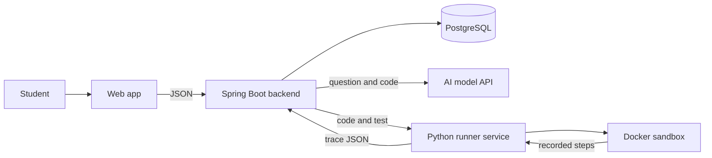

# MentorLens

**See exactly why your code failed.**

MentorLens helps students who are stuck on LeetCode or HackerRank-style coding questions. Paste your question, your code and the failing test. MentorLens really runs the code, shows it step by step next to a correct version, and stops at the first step where the two differ.

> **Status: planning and setup.** No application code exists yet. This README describes what we are building, not what works today. See the [roadmap](#roadmap).

## The problem

Your code fails on a coding platform. It says "Wrong Answer" and shows a test, but not where your thinking went wrong. A chatbot can hand you the answer, but then you still don't know why your version failed, and you make the same mistake next time.

## How it works

1. **Paste** the question, your `Solution` code and the failing test.
2. **Run:** MentorLens adds the parts coding platforms hide (main function, imports, input conversion and helper types like `ListNode`) and runs your code in a sandbox.
3. **Compare:** your run and a correct version's run are replayed side by side, and the first difference is highlighted.
4. **Understand:** the AI explains the mistake using the real values from your run.
5. **Try again:** hints come first, and the correct version comes last.

```
Failing test: numbers = [2,7,11,15], target = 9

  YOUR CODE                     CORRECT VERSION
  left = 0, right = 3           left = 0, right = 3
  total = 17                    total = 17
> left += 1                   > right -= 1
  left = 1  <- first difference right = 2
```

## Features

### Core

| Feature | What you get |
| --- | --- |
| Paste and run | Runs a bare `Solution` class, with no `main` function needed |
| Step-by-step visualization | Each line, its variables and a drawing of the data, taken from real execution |
| Side-by-side comparison | The first step where your run differs from a correct one |
| Explanation | What happened, where it went wrong and why |
| Hint ladder | Nudge, then pointer, then guided fix, then the correct version |
| Report | Score, time and space complexity, tips and mistake type |

### Planned next

| Feature | What you get |
| --- | --- |
| Smallest failing test | A huge failing input reduced to a few values that still fail |
| Predict the next step | The replay pauses and asks what happens next |
| Mistake tracker | Your repeated mistake types, with practice suggestions |

### What we keep honest

- **Steps are never invented.** The visualization only shows what really ran.
- **The correct version is tested first.** If it fails the test, it isn't used for comparison.
- **AI-written tests are labelled.** They only count once a tested correct version passes them.

## Architecture



More detail: [architecture](docs/architecture.md) and [API contract](docs/api-contract.md).

## Tech stack

| Part | Technology |
| --- | --- |
| Frontend | HTML, CSS, JavaScript and Monaco Editor |
| Backend | Java 17+ and Spring Boot |
| Runner | Python 3.10+, FastAPI and `sys.settrace` |
| Sandbox | Docker with no network, plus time and memory limits |
| Database | PostgreSQL |
| AI | Hosted model API, with the key kept on the server |

Python is the first supported language for submitted code.

## Repository structure

```
ai-code-review-platform/
├── backend/    Spring Boot API, AI calls, scoring, database
├── runner/     Driver generation, sandbox, step recording
├── frontend/   Workspace, visualization, dashboard
├── tests/      Buggy samples with expected results
├── docs/       Architecture, API contract, team rules
└── README.md
```

## Team

| Member | Role | Folder |
| --- | --- | --- |
| Anuj | Team Leader, backend, AI feedback, scoring | `backend/` |
| Aryan | Runner, sandbox, step recording | `runner/` |
| Abhi | Workspace and visualization | `frontend/` |
| Rudra | Dashboard, sample dataset, documentation | `frontend/`, `tests/` |

## Getting started

There is nothing to run yet. Each folder's README lists its setup steps and what its owner builds first:

- [backend](backend/README.md)
- [runner](runner/README.md)
- [frontend](frontend/README.md)
- [tests](tests/README.md)

## Roadmap

- [ ] **Step 1, one working path:** paste code, run it on a failing test and see the steps
- [ ] **Step 2, comparison:** side-by-side run, first difference and explanation
- [ ] **Step 3, learning:** hint ladder, score and complexity
- [ ] **Step 4, extras:** smallest failing test, predict the next step and mistake tracker
- [ ] **Step 5, evaluation:** student pilot comparing step-based feedback with AI explanation alone

**Later**

- More languages: Java and C++
- Repo explainer: link a repository, then explore it through AI explanations and diagrams
- Users adding their own AI API key

## Contributing

Read the [team rules](docs/team-rules.md) before your first commit. In short: never push to `main`, work on your own branch, and open a small pull request for every task.
