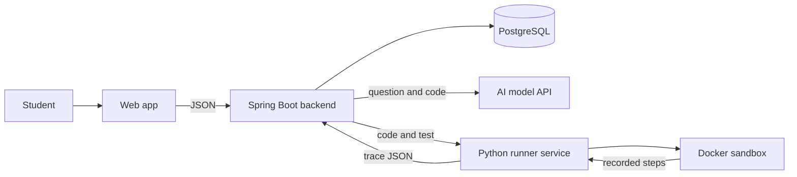
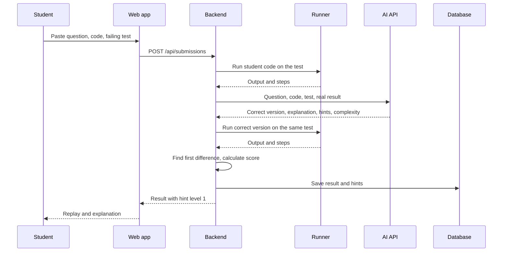
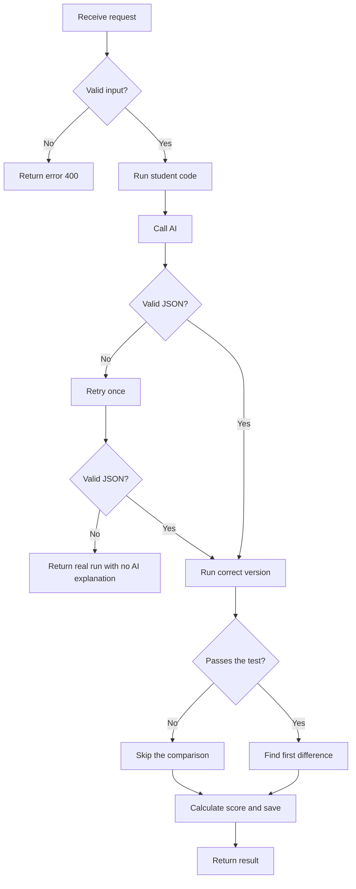

# Architecture

## System overview



## Layers
- Presentation: workspace, side-by-side visualization and progress dashboard.
- Application: Spring Boot REST API (controller, service, repository). Only the backend calls other services.
- Execution: the runner adds the hidden parts, runs code in the sandbox and records each step.
- Intelligence: the AI writes the correct version, explanation, hints and complexity estimate.
- Data: PostgreSQL for submissions, results, hints and progress.

## What the runner adds
Coding platforms hide these parts from students, so the runner supplies them:

| Piece | Job |
| --- | --- |
| Imports | Adds common imports such as `from typing import List` |
| Driver | Creates `Solution` and calls the student's method |
| Input conversion | Turns test input into real data |
| Helper types | Provides `ListNode` and `TreeNode` |
| Step recorder | Records each line and its variables with `sys.settrace` |

## Request flow



Later hints are served from the database with no new AI call.

## Backend flow



## Rules that keep it honest
- Steps always come from real execution, never from the AI.
- The AI's correct version must pass the failing test before it is used.
- The AI is asked for a correct version that keeps the student's approach, so the two runs can be compared. If they still can't be matched, show only where the output goes wrong.
- Pass or fail comes only from the real run on the student's test. The AI never decides it.

## Sandbox
Each run uses a fresh container with no network, a time limit, a memory limit, a read-only file system except for a temporary directory, and a non-root user. Runs go through a queue with a limit on how many run at once, so a whole lab can submit together.

## Score

```
Q = max( 0, 100 - sum(weight x count) )
```

- The score is `Q`, a code quality score out of 100, and is a guide, not a grade.
- It comes from AI-reported quality issues. Bugs weigh more than style problems.
- Pass or fail is shown separately and comes only from the real run.
- With no checked AI reply, there is no score, so `score` is `null`.
- The weights will be tuned during testing.

## Who owns what
| Part | Owner |
| --- | --- |
| Backend, AI feedback, comparison, score, database | Anuj |
| Runner, sandbox, queue | Aryan |
| Workspace and visualization | Abhi |
| Dashboard, sample dataset, documentation | Rudra |

Parts talk to each other only through JSON over HTTP. See `api-contract.md`.
