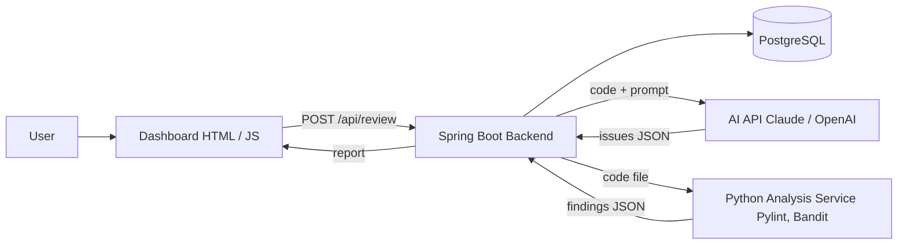
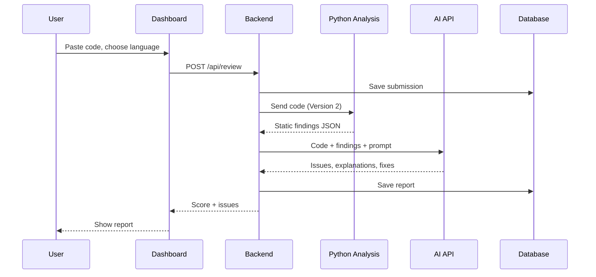
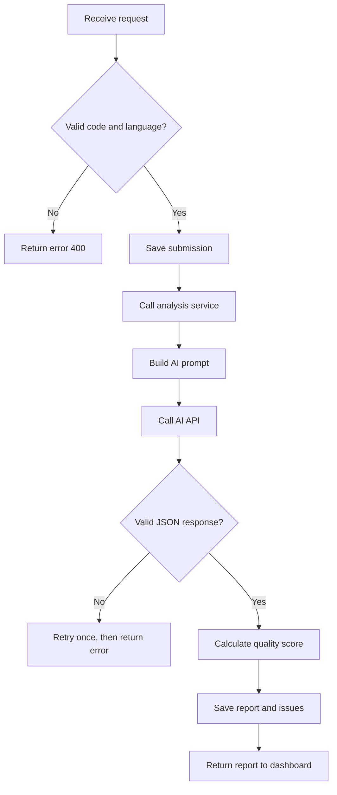

# Architecture

## System overview

## Layers
- Presentation: dashboard with code box, language picker, report page.
- Application: Spring Boot REST API (controller, service, repository).
- Intelligence: AI API client, plus the Python analysis service from Version 2.
- Data: PostgreSQL for submissions, reports and issues.

## Request flow

## Backend flow

## Who owns what
| Part | Owner |
| --- | --- |
| Backend, AI call, database, score | Team Leader |
| Python analysis service | Aryan |
| Input page | Abhi |
| Report page | Rudra |

Parts talk to each other only through JSON over HTTP. See `api-contract.md`.

## Quality score
`Score = 100 - sum(weight x count)` per issue type. Security issues weigh the most, then bugs, then style problems. The score never goes below 0.
